<picture>
  <source media="(prefers-color-scheme: dark)" srcset="assets/hero-dark.svg" />
  <source media="(prefers-color-scheme: light)" srcset="assets/hero-light.svg" />
  
</picture>

  
  
  
  
  

I'm an **AI Engineer at AIVantage**, building enterprise GenAI: RAG-based conversational systems, LangGraph multi-agent workflows and the Azure plumbing that takes them to production.
Before that I did industrial **computer vision** at Kevision Systems. B.Tech in Computer Science from **Nirma University** (2025).

### 💼 What I've shipped

#### AI Engineer · AIVantage
 

- 💬 **Enterprise RAG chat** over structured financial data: natural-language questions answered from PostgreSQL by LLMs
- 🕸️ **Multi-agent workflows in LangGraph**: fan-out across **10 parallel model calls**, with model routing and response evaluation
- 🩺 **Clinical case review AI**: reads **1,000+ page** medical records with OCR, multilingual translation and LLM analysis
- ⚙️ **4+ enterprise automations** on FastAPI, Azure Functions, Microsoft Fabric, Graph API and SharePoint

#### Software Engineer · Kevision Systems
 

- 🏭 Industrial object detection and segmentation at **92%+ accuracy**
- ⚡ Image pipelines **45% faster**, latency **under 10 ms**; ORB/SIFT/SURF matching lifted pattern recognition **35%**

### ⚡ Selected projects

| | Project | Highlights |
|:-:|---|---|
| 📚 | **[Local Multi-Agent RAG](https://github.com/VijayJoshi17/multi_agent_rag_local)** | Privacy-first, fully local. **10+ agents** (LangGraph, Ollama, Qdrant); hybrid retrieval + cross-encoder reranking **+35% relevance**; **sub-2s** answers |
| 🚗 | **[Drowsiness Detection (CNN)](https://github.com/VijayJoshi17/Drowsiness-Detection-System)** | **89.9% accuracy** on a custom dataset of facial posture and fatigue cues |
| 🌪️ | **[Disaster Tweets Analysis](https://github.com/VijayJoshi17/Disaster-Tweets-Streamlit)** | Streamlit app comparing 5 ML models; Random Forest hits **98.52%** test accuracy |
| 🧩 | **[Codebase Intelligence](https://github.com/VijayJoshi17/Codebase-Intelligence-App)** | Ask questions about any codebase, answered with context-aware RAG |
| 🤖 | **[Autonomous Interview Platform](https://github.com/VijayJoshi17/autonomous-interview-platform)** | Interviews run end to end by AI agents |

### 🏆 Highlights

- 🥇 **Top 4%** (56 / 1502) — Kaggle Playground S3E17, *Binary Classification of Machine Failures*
- 🥈 **Top 11%** (146 / 1429) — Kaggle Playground S3E16, *Regression with a Crab Age Dataset*
- 🎖️ **Kaggle 2× Expert** (Notebooks and Discussions)
- 🌐 AI/ML Core Team, **Google Developer Student Club**, Nirma University

### 🧰 Toolbox

  
  
  
  
  
  
  
  
  
  
  

  

### 🕸️ How my agents think

<picture>
  <source media="(prefers-color-scheme: dark)" srcset="assets/pipeline-dark.svg" />
  <source media="(prefers-color-scheme: light)" srcset="assets/pipeline-light.svg" />
  
</picture>

Open to conversations about GenAI, agents and RAG — <a href="mailto:joshivijay2004@gmail.com">say hi</a>.

